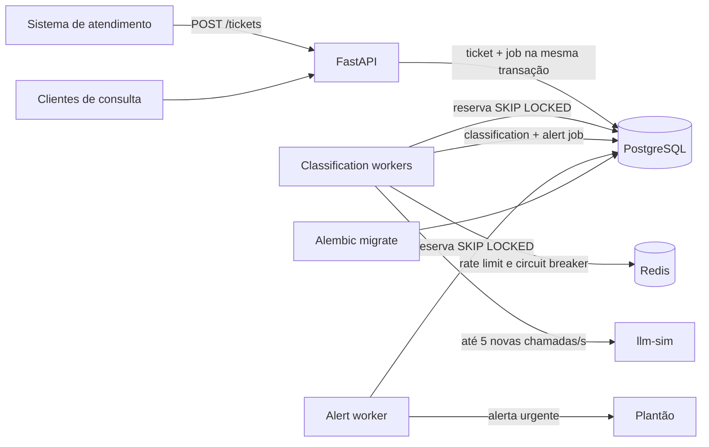
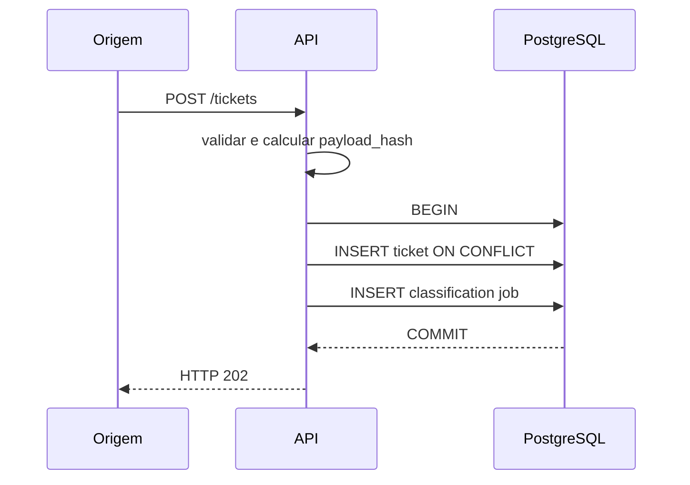
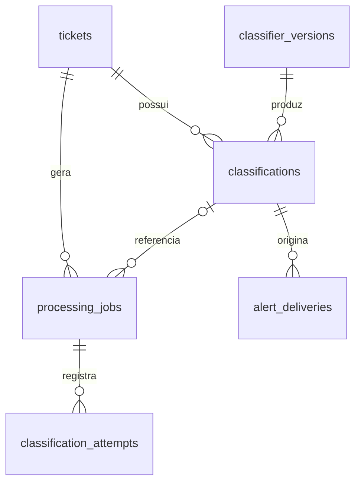
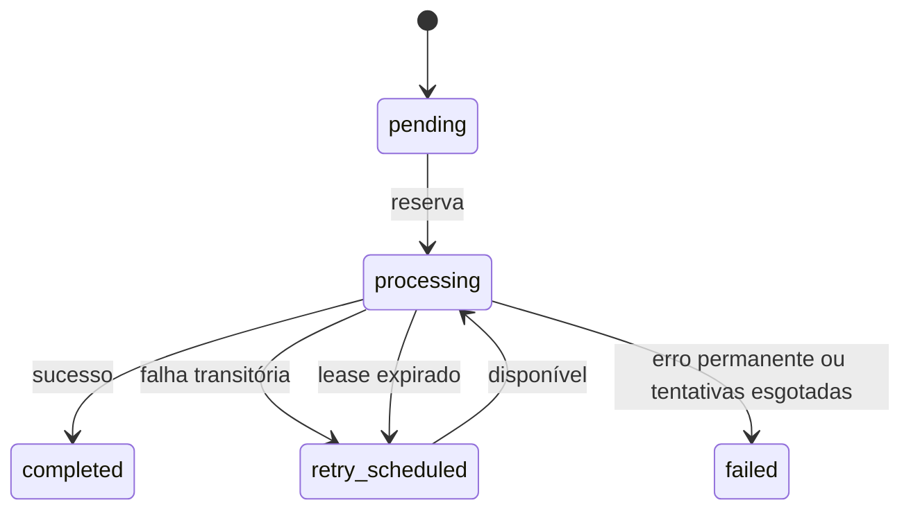

# Triagem de Tickets

## 1. Contexto

Serviço de triagem assíncrona de tickets de e-commerce. O sistema de origem pode enviar rajadas
de até 50 tickets por segundo, espera no máximo 2 segundos pela resposta e repete a requisição
em caso de timeout, erro de conexão ou HTTP 5xx.

A API responde à ingestão depois de validar e confirmar no PostgreSQL tanto o ticket quanto seu
job de classificação. A classificação por IA e a entrega de alertas acontecem fora da requisição
HTTP. Assim, indisponibilidade do LLM ou do plantão não impede a aceitação de novos tickets.

Endpoints:

| Método e rota | Finalidade |
|---|---|
| `GET /health/live` | Verifica se o processo da API está ativo |
| `GET /health/ready` | Verifica se a API pode ingerir com durabilidade e informa degradações |
| `GET /metrics` | Expõe métricas Prometheus do processo da API |
| `POST /tickets` | Valida e persiste ticket e job; retorna HTTP 202 |
| `GET /tickets/{external_id}` | Retorna ticket, classificação atual e processamento pendente |
| `GET /tickets` | Lista com filtros por categoria, prioridade e período |
| `GET /tickets/{external_id}/classifications` | Lista o histórico versionado de classificações |
| `POST /tickets/{external_id}/reclassify` | Enfileira uma nova classificação; retorna HTTP 202 |
| `GET /tickets/{external_id}/timeline` | Reconstrói o histórico operacional do ticket |

## 2. Requisitos

- Git;
- Docker com Docker Compose;
- kit oficial do desafio em outro diretório;
- Python 3.12+ somente para execução ou validações fora do Docker.

Os containers da aplicação e do kit compartilham a rede externa `desafio-kit`. O kit deve ser
iniciado primeiro, pois seu Compose cria essa rede.

## 3. Arquitetura

Stack: Python 3.12, FastAPI, Pydantic, SQLAlchemy assíncrono, asyncpg, Alembic, PostgreSQL,
Redis, HTTPX, pytest, Ruff, MyPy e Docker Compose.



O PostgreSQL é a fonte de verdade para tickets, jobs, classificações e tentativas. Redis armazena
somente coordenação operacional do rate limiter e do circuit breaker. A perda do Redis não apaga
trabalho durável.

O Compose inicia uma API, três réplicas do `classification-worker` e um `alert-worker`. A API
possui pool PostgreSQL de 5 conexões mais 10 de overflow; cada worker usa pool de 2 conexões sem
overflow.

`/health/live` informa somente que o processo da API está vivo. `/health/ready` representa a
capacidade da API de ingerir com durabilidade: PostgreSQL indisponível resulta em HTTP 503;
PostgreSQL saudável com Redis indisponível resulta em HTTP 200 e `status=degraded`, mantendo
`checks.redis=error` visível. LLM e plantão não participam do readiness.

Redis é uma dependência operacional degradável da API, não da ingestão. Os classification workers
continuam dependendo dele para coordenar rate limit e circuit breaker com segurança e falham
fechado enquanto estiver indisponível.

## 4. Fluxo de ingestão

Contrato de entrada:

```json
{
  "external_id": "ATD-2026001",
  "cliente": {
    "id": "CLI-00078",
    "nome": "João Gomes",
    "email": "joao@example.com"
  },
  "assunto": "Pedido atrasado",
  "mensagem": "Meu pedido ainda não chegou.",
  "canal": "email",
  "criado_em": "2026-10-20T12:00:00Z"
}
```

`mensagem` é obrigatória e não pode conter apenas espaços; `criado_em` precisa ter fuso horário.
E-mail, campos vazios e os limites dos demais campos são validados pelo Pydantic. O conteúdo
integral da mensagem é persistido antes do processamento assíncrono.



A API não chama Redis, LLM ou plantão nesse fluxo. Se o PostgreSQL não confirmar a transação,
sucesso não é retornado.

Respostas principais:

- `202`: ticket aceito ou repetição idempotente;
- `409`: o `external_id` já existe com payload semanticamente diferente;
- `422`: payload inválido;
- `5xx`: falha que impediu a confirmação no PostgreSQL.

## 5. Fluxo de classificação

O worker executa:

```text
job durável
→ rate limiter global
→ circuit breaker
→ cliente HTTPX
→ parser
→ validação Pydantic
→ persistência da classification
→ job COMPLETED
```

O cliente envia ao `llm-sim` o modelo `triagem-sim-1`, instruções no campo `system` e somente
`assunto` e `mensagem` no campo `input`. Nome, e-mail e identificador do cliente não são enviados.

O parser aceita JSON puro, JSON em markdown fence ou um único objeto JSON com pequeno texto ao
redor. A saída sempre passa por validação estrutural e semântica. Valores fora dos enums não são
convertidos: por exemplo, `critical` não vira `urgente`.

Campos persistidos incluem categoria, prioridade, sentimento, sugestão de resposta, versão do
classificador, id e modelo do provedor, saída bruta validada, usage, custos, indicação de
truncamento do input e timestamps.

## 6. Fluxo de alertas

Uma classificação com prioridade `urgente` cria, na mesma transação da classificação:

- uma tentativa inicial em `alert_deliveries`;
- um job durável do tipo `alert_delivery`.

O `alert-worker` é independente do worker de classificação. Falha no plantão reagenda apenas
o job de alerta e nunca provoca outra chamada ao LLM.

Payload:

```json
{
  "external_id": "ATD-2026001",
  "categoria": "pagamento",
  "prioridade": "urgente",
  "resumo": "Resumo determinístico limitado a 280 caracteres.",
  "detectado_em": "2026-10-20T12:00:00Z"
}
```

O resumo é derivado do assunto e da mensagem; não existe uma segunda chamada à IA. HTTP 202
conclui a entrega, 503/timeout/rede geram retry e 422 é falha permanente.

A semântica é **at-least-once**. Se o plantão aceitar o alerta e o worker falhar antes do commit
local, a recuperação pode repetir o envio. O contrato do plantão não fornece chave de
idempotência, portanto exactly-once não é prometido.

## 7. Modelo de dados

| Tabela | Responsabilidade |
|---|---|
| `tickets` | Ticket original, hash idempotente, status e timestamps |
| `classifier_versions` | Identidade imutável de provedor, modelo, prompt e schema |
| `classifications` | Histórico append-only de resultados e custos |
| `processing_jobs` | Fila durável de classificação e entrega de alerta |
| `classification_attempts` | Histórico de reservas, retries e erros de classificação |
| `alert_deliveries` | Uma linha por tentativa de entrega ao plantão |



Foreign keys usam `RESTRICT` para proteger o histórico. `classifications.ticket_id` não é único:
um ticket pode possuir várias classificações. Índices cobrem recebimento por período, categoria,
prioridade, polling de jobs, recuperação de lease e classificação mais recente.

## 8. Idempotência

`external_id` possui constraint `UNIQUE` no PostgreSQL. A aplicação não depende de um `SELECT`
preventivo: usa `INSERT ... ON CONFLICT DO NOTHING`, mantendo a constraint como proteção final
contra concorrência.

O `payload_hash` é SHA-256 do modelo validado, serializado com chaves ordenadas e timestamp
normalizado para UTC.

- Mesmo `external_id` e mesmo hash: retorna o ticket existente, sem novo ticket ou job.
- Mesmo `external_id` e hash diferente: retorna HTTP 409.
- Chamadas concorrentes: somente a transação vencedora cria o job.

Ticket e job são confirmados no mesmo commit.

## 9. Processamento assíncrono

Os workers reservam um job por vez com `SELECT ... FOR UPDATE SKIP LOCKED`. A reserva é
confirmada antes de qualquer HTTP externo, evitando manter locks durante chamadas lentas.

Novos jobs recebem `queue_priority=100` quando assunto ou mensagem contêm indícios fortes de
fraude, invasão de conta, cartão clonado, cobrança não reconhecida ou duplicada, comprometimento
de segurança, urgência explícita ou emergência. Os demais recebem `0`. Essa heurística define
somente a ordem da fila: categoria, prioridade final, sentimento e alertas continuam dependendo
exclusivamente do resultado validado do LLM.

A heurística de urgência não é uma classificação alternativa. Ela é usada exclusivamente para
scheduling da fila e busca reduzir o tempo até análise pelo LLM dos tickets com maior risco
aparente.



`locked_at` define o lease. `locked_by` e `attempt_count` formam um fencing token: um worker que
perdeu o lease não consegue concluir o job depois que outro worker o reservou. Leases expirados
voltam para `retry_scheduled` enquanto houver tentativas.

O polling ocorre a cada 0,5 segundo e o lease de classificação é 60 segundos. O batch permanece
unitário para não deixar vários jobs reservados enquanto aguardam o limite do LLM.

## 10. Rate limiting

O limite global usa uma janela deslizante no Redis e um script Lua atômico. O relógio vem de
`Redis TIME`, de modo que todos os workers compartilham a mesma decisão. O padrão é:

- `LLM_RATE_LIMIT_RPS=5` para novas chamadas por segundo;
- `LLM_MAX_CONCURRENCY=5` para concorrência local por processo.

Concorrência e taxa temporal são controles diferentes. Um semáforo não substitui o rate limiter.
Quando a janela está cheia, o cliente aguarda a permissão; essa espera é observada em
`llm_rate_limit_wait_total`.

Se Redis estiver indisponível, o cliente falha fechado e o job é reagendado no PostgreSQL. Não há
fallback que possa exceder a quota do provedor.

**Restrição de capacidade:** a entrada pode atingir 50 tickets/s enquanto o provedor admite no
máximo 5 novas chamadas/s. Com 50 tickets válidos e únicos por segundo, chegam 3.000 tickets em um
minuto e podem ser iniciadas no máximo 300 chamadas nesse período. Antes de considerar retries ou
latência do modelo, a fila cresce em pelo menos 2.700 jobs. Portanto, sob carga sustentada acima da
capacidade do provedor, não existe garantia matemática de classificação de todos os tickets dentro
de um minuto. A arquitetura garante durabilidade e processamento posterior, não esse SLA.

## 11. Retry

Retries são persistidos em `processing_jobs.available_at`. O worker não dorme durante backoff;
outro job disponível pode ser processado.

| Falha | Tratamento |
|---|---|
| LLM 429 | Retry respeitando `Retry-After` |
| LLM 500/503 | Retry |
| Timeout ou erro de rede do LLM | Retry |
| Output inválido | Retry limitado |
| LLM 401/403 | Falha permanente de configuração |
| HTTP 400, inclusive `context_length_exceeded` | Falha permanente para o mesmo payload |
| Redis/rate limiter indisponível | Reagenda sem consumir tentativa de provedor |
| Circuito aberto | Reagenda sem consumir tentativa de provedor |
| Plantão 503/5xx, timeout ou rede | Retry do alerta |
| Plantão 422/4xx | Falha permanente do alerta |

O atraso usa backoff exponencial com jitter de até 25% e teto configurável. `attempt_count` e
`max_attempts` impedem loops infinitos. Erros são persistidos com códigos e mensagens operacionais
sanitizadas.

Novos jobs usam budgets configuráveis: `CLASSIFICATION_MAX_ATTEMPTS=8` para classificação e
`ALERT_MAX_ATTEMPTS=8` para entrega. Alterar essas variáveis afeta apenas jobs criados depois da
mudança; jobs já persistidos mantêm seu budget original.

## 12. Circuit breaker

O circuit breaker do LLM é distribuído pelo Redis e possui estados `closed`, `open` e
`half_open`.

- timeout, transporte e HTTP 5xx contam como falha de disponibilidade;
- 429, 4xx e output inválido indicam que o provedor respondeu e não abrem o circuito;
- ao atingir o limiar, o circuito abre e evita chamadas inúteis;
- após o período de recuperação, apenas um worker recebe o probe em `half_open`;
- sucesso fecha o circuito; falha do probe o abre novamente.

O circuit breaker não armazena tickets nem substitui a fila. Durante um outage, os jobs continuam
duráveis no PostgreSQL.

## 13. Versionamento

Cada resultado referencia exatamente uma linha de `classifier_versions`. A identidade
`provider + model_name + version` é única e inclui a definição imutável do prompt e a versão do
schema de saída.

Reutilizar a mesma identidade com prompt ou schema diferente falha antes da chamada ao LLM. Uma
reclassificação cria novo job e nova linha em `classifications`; resultados anteriores nunca são
sobrescritos.

Classificações são append-only; reprocessar nunca sobrescreve resultados históricos. O endpoint de
reclassificação apenas cria um job durável e retorna HTTP 202: a versão usada será a versão atual
carregada pelo worker. Se já existir um job de classificação em estado processável, a API retorna
HTTP 409 para evitar reclassificações concorrentes acidentais.

`GET /tickets/{external_id}/classifications` retorna todas as classificações em ordem
determinística. `GET /tickets/{external_id}` preserva os campos anteriores e inclui `usage` e custo
na classificação atual. Dessa forma, alterar `CLASSIFIER_PROMPT_VERSION`, reclassificar e comparar
as versões não exige sobrescrever o resultado anterior.

## 14. Custos

Os cálculos usam `Decimal` e são persistidos como `NUMERIC(20, 8)`:

```text
input_cost  = input_tokens  × Decimal("0.40") / Decimal("1000000")
output_cost = output_tokens × Decimal("1.60") / Decimal("1000000")
total_cost  = input_cost + output_cost
```

Constraints garantem que os três valores estejam todos presentes ou todos ausentes, sejam
não negativos e que o total seja a soma exata. O contador Prometheus é aproximado por exigência
do protocolo; o valor financeiro autoritativo é o `Decimal` do PostgreSQL.

As consultas HTTP representam custos como strings com oito casas decimais. Assim, a API não
converte valores financeiros para ponto flutuante e preserva a precisão armazenada.

## 15. Segurança

- O ticket é dado não confiável; instruções do cliente nunca entram no `system`.
- Apenas assunto e mensagem são enviados ao LLM.
- Nome, e-mail e customer id não são enviados ao provedor.
- Authorization, API keys, e-mail, mensagem completa, output bruto e system prompt não entram em
  logs operacionais.
- `X-Request-ID` é aceito somente com formato seguro e até 128 caracteres; valores hostis são
  substituídos por UUID.
- Mensagens são persistidas integralmente; somente o input serializado do classificador é limitado
  a 8.000 caracteres, preservando o começo e o final quando houver truncamento.
- Enums e schemas Pydantic validam a saída do LLM; o prompt não é tratado como fronteira de
  segurança.
- A credencial presente no `.env.example` é somente a chave pública do simulador oficial. Segredos
  reais devem ser injetados pelo ambiente e não versionados.

Unicode, HTML, JSON e tentativas de prompt injection permanecem texto no campo `input`. A saída
bruta validada é armazenada para auditoria no PostgreSQL e deve receber os mesmos controles de
acesso e retenção aplicados aos demais dados do ticket.

## 16. Observabilidade

Logs são JSON de uma linha. Quando disponíveis, incluem `request_id`, `external_id`, `job_id`,
`classification_id`, `alert_id` e `provider_request_id`.

Eventos principais:

- `ticket_received` e `ticket_duplicate`;
- `classification_started`, `classification_retry`, `classification_completed` e
  `classification_failed`;
- `alert_created`, `alert_attempt`, `alert_retry`, `alert_delivered` e `alert_failed`.

Os eventos de ingestão incluem `queue_priority`, mas não incluem assunto ou mensagem do cliente.

Métricas principais:

- tickets recebidos e duplicados;
- classificações concluídas, em retry, falhas e profundidade da fila;
- chamadas, erros, 429, tokens, custo e esperas locais do rate limiter;
- alertas entregues e em retry;
- `alert_request_duration_seconds`, que mede somente a chamada HTTP ao plantão;
- `urgent_alert_end_to_end_seconds`, que mede de `tickets.received_at` até
  `alert_deliveries.delivered_at`, e `urgent_alert_sla_violations_total`, incrementado quando essa
  duração ultrapassa 60 segundos;
- histogramas de ingestão, fila, LLM, classificação e processamento total;
- capacidade, conexões abertas e conexões em uso no pool PostgreSQL.

A API expõe `/metrics`. Cada worker possui registry e exporter próprios na porta interna definida
por `METRICS_PORT`; um coletor deve fazer scrape de API, workers de classificação e worker de
alerta separadamente.

`GET /tickets/{external_id}/timeline` deriva eventos das tabelas de domínio e mostra recebimento,
fila, tentativas, retries, erros, classificação e alertas sem criar uma tabela genérica de
auditoria.

## 17. Como executar

### 17.1 Clonar e configurar

```bash
git clone https://github.com/EnzoGui18/Triagem-Tickets.git
cd Triagem-Tickets
cp .env.example .env
```

No PowerShell:

```powershell
Copy-Item .env.example .env
```

Os valores padrão são apenas para desenvolvimento com o kit. Altere credenciais em qualquer outro
ambiente.

### 17.2 Subir o kit oficial

No diretório do kit:

```bash
cp .env.example .env
docker compose up -d --build
curl --fail http://localhost:8081/health
curl --fail http://localhost:8082/health
```

O kit deve criar a rede `desafio-kit`. Não crie a rede manualmente antes dele.
No PowerShell, use `Copy-Item .env.example .env` e invoque `curl.exe` explicitamente para evitar
o alias `curl` presente em algumas versões.

### 17.3 Subir a aplicação

No diretório deste projeto:

```bash
docker compose config --quiet
docker compose build
docker compose run --rm migrate
docker compose up -d
docker compose ps
```

O serviço `migrate` também é uma dependência de inicialização da API e dos workers. A API fica em
`http://localhost:8000`.

### 17.4 Smoke test

No PowerShell, use `curl.exe` para os GETs. Para o POST com JSON e caracteres Unicode, use o
exemplo nativo logo após o bloco Bash; isso evita diferenças de parsing de argumentos entre
versões do PowerShell e do `curl.exe`.

```bash
curl --fail http://localhost:8000/health/live
curl --fail http://localhost:8000/health/ready
curl --fail http://localhost:8000/metrics

curl --fail-with-body \
  -H "Content-Type: application/json" \
  -d '{"external_id":"ENTREGA-SMOKE-001","cliente":{"id":"CLI-SMOKE-001","nome":"Cliente Smoke","email":"smoke@example.com"},"assunto":"Pedido atrasado","mensagem":"Meu pedido ainda não chegou e o prazo já terminou.","canal":"email","criado_em":"2026-10-20T12:00:00Z"}' \
  http://localhost:8000/tickets
```

Equivalente no PowerShell:

```powershell
$body = @{
  external_id = "ENTREGA-SMOKE-001"
  cliente = @{
    id = "CLI-SMOKE-001"
    nome = "Cliente Smoke"
    email = "smoke@example.com"
  }
  assunto = "Pedido atrasado"
  mensagem = "Meu pedido ainda não chegou e o prazo já terminou."
  canal = "email"
  criado_em = "2026-10-20T12:00:00Z"
} | ConvertTo-Json -Depth 3 -Compress

$bytes = [System.Text.Encoding]::UTF8.GetBytes($body)
Invoke-RestMethod -Method Post `
  -Uri http://localhost:8000/tickets `
  -ContentType "application/json; charset=utf-8" `
  -Body $bytes
```

O POST deve retornar HTTP 202. Repetir exatamente o mesmo payload deve retornar o mesmo UUID.

### 17.5 Carga e consultas

No diretório do kit:

```bash
docker compose --profile carga run --rm carga --limite 20
docker compose --profile carga run --rm carga
```

De volta ao projeto:

```bash
curl --fail http://localhost:8000/tickets/ENTREGA-SMOKE-001
curl --fail http://localhost:8000/tickets/ENTREGA-SMOKE-001/timeline
curl --fail http://localhost:8000/tickets/ATD-2026001/classifications
curl --fail -X POST \
  http://localhost:8000/tickets/ATD-2026001/reclassify
curl --fail "http://localhost:8000/tickets?page=1&page_size=20"
curl --fail "http://localhost:8000/tickets?categoria=entrega&prioridade=alta&page=1&page_size=20"
curl --fail http://localhost:8082/alertas
curl --fail http://localhost:8081/admin/stats
```

A classificação é assíncrona. Consulte novamente o ticket e sua timeline para observar a
transição do job. Alertas aparecem somente para classificações urgentes.

Para encerrar a aplicação preservando volumes:

```bash
docker compose down
```

### 17.6 Execução local opcional

Disponibilize PostgreSQL e Redis no host e altere `DATABASE_URL` e `REDIS_URL`. Como o kit publica
os simuladores no host, use `LLM_BASE_URL=http://localhost:8081` e
`PLANTAO_BASE_URL=http://localhost:8082`.

```bash
python -m venv .venv
source .venv/bin/activate
python -m pip install -e ".[dev]"
alembic upgrade head
uvicorn triagem.main:app --reload
```

No PowerShell, a ativação é `.\.venv\Scripts\Activate.ps1`.

### 17.7 Recuperação operacional de jobs falhos

O comando abaixo cria um novo job de classificação para o ticket quando seu job mais recente está
em `failed`:

```bash
python -m triagem.tools.requeue_failed --external-id ATD-2026001
```

Com a aplicação em Docker, use o mesmo comando no serviço da API:

```bash
docker compose run --rm api python -m triagem.tools.requeue_failed --external-id ATD-2026001
```

Para recuperar todos os tickets elegíveis, substitua o filtro por `--all`. O job falho e suas
tentativas permanecem intactos para auditoria; o novo job recebe um budget independente definido
por `CLASSIFICATION_MAX_ATTEMPTS`. Jobs concluídos ou que já possuem processamento posterior não
são reabertos. O mecanismo não oferece retry infinito.

## 18. Como testar

Validações estáticas e testes locais:

```bash
ruff check .
mypy src
pytest
```

Sem `TEST_DATABASE_URL` e `REDIS_URL`, o pytest local pula explicitamente os testes de
infraestrutura. A suíte completa usa PostgreSQL e Redis reais no perfil Docker:

```bash
docker compose --profile test run --rm test
docker compose run --rm migrate alembic check
```

O workflow [`.github/workflows/ci.yml`](.github/workflows/ci.yml) executa automaticamente em
pushes, pull requests e acionamento manual. Os checks separados são `Lint`, `Types`, `Tests`,
`Migrations` e `Docker build`. Os testes usam serviços efêmeros PostgreSQL 16 e Redis 7 no GitHub
Actions; o kit oficial e seus simuladores não são necessários no CI principal.

O CI usa Python 3.12 e o mesmo comando de instalação local, `pip install -e ".[dev]"`. Um
`uv.lock` não foi introduzido nesta fase para não criar um segundo fluxo de instalação diferente
do Docker e da documentação já validados. Fixar transitivamente as dependências com um único
lockfile para desenvolvimento, CI e imagens permanece uma evolução futura.

Os testes cobrem validação, idempotência concorrente, constraints, upgrade/downgrade de migrations,
workers concorrentes, lease recovery, parser, rate limiter distribuído, circuit breaker, custos,
consultas, alertas, timeline, observabilidade e inputs hostis.

## 19. Testes de falha

Execute os cenários com tickets de `external_id` novos para não confundir idempotência com uma nova
ingestão.

| Cenário | Ação | Comportamento esperado |
|---|---|---|
| LLM indisponível | `POST /admin/outage?segundos=60` no `llm-sim` | `POST /tickets` continua 202; jobs retomam após o outage |
| Worker de classificação parado | `docker compose stop classification-worker` | Tickets e jobs permanecem no PostgreSQL |
| Worker de alerta parado | `docker compose stop alert-worker` | Classificação urgente cria alerta pendente sem chamar novamente o LLM |
| Redis parado | `docker compose stop redis` | Readiness 200/degraded; ingestão continua 202; classificação aguarda |
| Ticket duplicado | Repetir exatamente o POST | Mesmo UUID, um ticket e um job |
| Conflito idempotente | Repetir o `external_id` alterando o payload | HTTP 409 |
| Payload inválido | Enviar mensagem vazia ou timestamp sem fuso | HTTP 422, sem persistência |
| Reinício da API | `docker compose restart api` | Dados aceitos permanecem consultáveis |

Outage do LLM:

```bash
curl --fail -X POST "http://localhost:8081/admin/outage?segundos=60"
```

Depois de testar processos parados, restaure-os com:

```bash
docker compose start classification-worker
docker compose start alert-worker
docker compose start redis
```

Confirme a recuperação por `/health/ready`, `GET /tickets/{external_id}` e
`GET /tickets/{external_id}/timeline`. Para o plantão, consulte `http://localhost:8082/alertas`.

## 20. Resultados reais

Os simuladores introduzem latência, erros e outputs inválidos aleatoriamente. Os números desta
seção foram medidos na regressão final, em 21 de outubro de 2026, com banco limpo, dataset e kit
oficiais sem alteração e a configuração apresentada neste repositório. Não são estimativas de
produção.

### 20.1 Regressão e carga finais

`ruff check .`, `mypy src`, build Docker, migrations em banco limpo e `alembic check` passaram. A
suíte integrada em Python 3.12, PostgreSQL e Redis reais terminou com 140 testes aprovados e um
warning de depreciação Starlette/httpx. O CI do commit validado concluiu com sucesso os cinco jobs:
lint, types, tests, migrations e Docker build.

| Métrica | Resultado |
|---|---:|
| Dataset oficial | 500 linhas; 485 `external_id` únicos |
| Respostas HTTP 202 | 496 |
| Payloads inválidos rejeitados | 4 linhas / 3 IDs, todos HTTP 422 |
| Tickets válidos rejeitados | 0 |
| Tickets únicos aceitos e persistidos | 482 |
| Classificações concluídas | 482 |
| Jobs terminais falhos | 0 |
| Tickets perdidos | 0 |
| Duplicações físicas | 0 |
| Tentativas de classificação | 598, sendo 116 adicionais |
| Respostas LLM 429 | 0 |
| Duração do envio do lote | 10,0 s |
| Latência média de ingestão | 163,912 ms |
| Ingestão p95 / p99 | ambas no bucket `(250, 500] ms` |

Na carga preliminar de 20 tickets, os 20 foram aceitos, persistidos e classificados, sem rejeição
ou retry do cliente.

O ticket oficial `ATD-2026338`, com 53.960 caracteres, recebeu HTTP 202 na primeira tentativa. A
mensagem integral permaneceu no PostgreSQL, a classificação terminou com `input_truncated=true` e
o simulador não registrou `context_length_exceeded`. O limite de 8.000 caracteres existe somente
na construção do input do LLM; não limita a ingestão nem altera `tickets.message`.

### 20.2 SLA urgente end-to-end

A medição usa `alert_deliveries.delivered_at - tickets.received_at`, incluindo fila, classificação,
criação do alerta e entrega ao plantão. Não é a latência isolada da requisição HTTP ao plantão.

| Métrica | Resultado |
|---|---:|
| Alertas urgentes entregues | 49 de 49 |
| p50 | 69,587 s |
| p95 | 229,539 s |
| p99 | 324,213 s |
| Máximo | 381,593 s |
| Entregues em até 60 s | 19 |
| Entregues acima de 60 s | 30 |
| Percentual em até 60 s | 38,78% |

No dataset oficial, 19 de 49 alertas urgentes foram entregues em até 60 segundos. O resultado não
atingiu a meta e não sustenta uma garantia de SLA de um minuto. A heurística de scheduling melhora
a ordem de análise, mas não elimina a limitação matemática de uma entrada potencial de 50 tickets/s
contra apenas 5 novas chamadas/s permitidas pelo provedor.

### 20.3 Recuperação e invariantes

Os testes finais confirmaram:

- outage real de 60 segundos do LLM: ingestão HTTP 202, retries persistidos e classificação após a
  recuperação;
- Redis indisponível: readiness HTTP 200/degraded, ingestão HTTP 202, job aguardando sem consumir
  tentativa e conclusão após a volta do Redis;
- reclassificação: histórico cresceu de uma para duas classificações sem sobrescrita;
- requeue: o job falho e suas tentativas antigas permaneceram consultáveis, um novo budget foi
  criado e o worker concluiu a classificação;
- 485 tickets existentes após todos os cenários estavam classificados e todos os urgentes tinham
  alert job explicável.

O relatório autoritativo, com método, contagens e limitações, está em
[`docs/final-validation-results.md`](docs/final-validation-results.md). Relatórios anteriores de
[carga](docs/load-test-results.md), [chaos](docs/e2e-chaos-results.md) e
[tuning](docs/performance-tuning-results.md) registram etapas históricas e não substituem a medição
final.

## 21. Trade-offs

### Capacidade versus SLA

A ingestão foi separada da classificação para cumprir o timeout do sistema de origem e preservar
durabilidade. Essa decisão permite absorver rajadas, mas transforma excesso sustentado de entrada
em backlog. Com entrada de 50 tickets/s e teto global de 5 novas chamadas/s, não há capacidade
suficiente para classificar tudo em até um minuto. Aumentar somente o número de workers não muda
essa conta enquanto a quota do provedor permanecer igual.

### PostgreSQL como fila

Usar PostgreSQL reduz componentes e mantém ticket e job na mesma transação. O custo é compartilhar
recursos entre API, consultas e workers. Uma fila dedicada pode escalar consumo melhor, mas exige
outbox/inbox ou outra estratégia para preservar atomicidade com o banco.

### Durabilidade versus latência

`synchronous_commit` foi preservado. Reduzi-lo melhoraria alguns percentis, mas permitiria
confirmar uma requisição antes da garantia de durabilidade exigida.

### Batch e concorrência

O batch unitário reduz exposição a leases vencidos enquanto o worker aguarda o rate limiter.
Três workers reduziram a espera da fila no teste, mas aumentaram p95/p99 da ingestão no host
compartilhado. Cinco workers tiveram contenção maior e não foram adotados como padrão.

### Disponibilidade e coordenação

O rate limiter falha fechado quando Redis está indisponível. Isso preserva o contrato de 5 req/s,
mas pausa classificações até a coordenação voltar. A ingestão continua porque não usa Redis.

### Sensibilidade versus justiça da fila

A heurística de agendamento privilegia recall: falsos positivos podem consumir capacidade antes
de tickets comuns, e uma chegada sustentada de sinais elevados pode aumentar a espera da fila
normal. Ela não antecipa a classificação nem cria alerta; apenas melhora o tempo até o LLM para
tickets potencialmente urgentes. Dentro da mesma prioridade, a ordem temporal continua sendo
preservada.

## 22. Limitações

- A quota de 5 novas chamadas/s é o principal limite de vazão da classificação.
- Novos jobs possuem oito tentativas por padrão, mas instabilidade longa ainda pode esgotar o
  budget e levá-los a `failed`; a recuperação exige a CLI de requeue ou intervenção operacional.
- A regressão final entregou apenas 19 de 49 alertas urgentes em até 60 segundos. Scheduling por
  indícios reduz espera relativa, mas não garante esse SLA sob backlog ou carga sustentada.
- O lease não possui heartbeat. Pausas do processo maiores que o lease podem causar recuperação e
  nova tentativa; fencing impede que o worker antigo grave um segundo resultado.
- Alertas são at-least-once e podem ser duplicados pelo plantão.
- Métricas são process-local; o Compose não inclui Prometheus para agregá-las.
- A API não implementa autenticação/autorização de aplicação; produção deve protegê-la em gateway
  ou camada equivalente.
- Não há política automática de retenção para payloads, outputs brutos, tentativas ou métricas.
- Os intervalos de dependências permitem novas versões compatíveis; não existe lock file para
  reprodução byte a byte.
- Os benchmarks foram executados em Docker Desktop com simuladores aleatórios e não representam
  capacidade de produção.

## 23. Evoluções futuras

- integrar múltiplos provedores com política explícita de fallback, custo e versionamento;
- negociar aumento de quota para remover o teto atual de 5 novas chamadas/s;
- avaliar classificação preliminar local apenas se houver necessidade além do agendamento
  heurístico atual;
- adotar modelos especializados por categoria ou complexidade;
- migrar para filas ou brokers dedicados quando volume e operação justificarem, preservando
  atomicidade com outbox/inbox;
- renovar leases com heartbeat para operações longas;
- agregar métricas dos processos em Prometheus e criar alertas operacionais;
- aplicar autenticação, autorização, gestão de segredos e políticas de retenção;
- negociar chave de idempotência com o plantão para reduzir duplicações de alertas;
- avaliar um único lockfile, consumido de forma consistente por ambiente local, CI e Docker.
